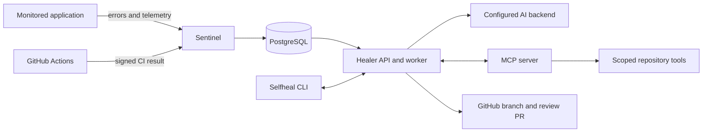

# Selfheal

- Capture runtime, contract, and CI failures.
- Gather scoped repository context through MCP tools.
- Propose candidate patches with a configured AI backend.
- Check patch policy and run tests in an isolated worktree.
- Open a GitHub pull request when verification succeeds.


[Repair-to-PR video](docs/demo-e2e-repairs.mp4) · [Terminal walkthrough](docs/demo-terminal.mp4)

Python 3.11+ · FastAPI · PostgreSQL · SQLAlchemy/Alembic · MCP · Typer · GitHub Actions

## Quick start

The CLI help runs without a database or provider credentials:

```powershell
python -m cli.main --help
```

For native PostgreSQL setup, local services, and credentials needed to run repairs, follow
[Local installation and operations](docs/operations.md). Keep local environment files out of Git.

## Real-world dogfooding

Engineer-directed testing against `multi-agent-workspace` exposed two bugs in Selfheal itself:
the scanner silently discarded dependency-audit findings when stderr corrupted JSON, and an
uncaught remote-verification exception could stop the worker. Both fixes have regression tests
([`ecba78b`](https://github.com/Deepak20466/selfheal-mcp-agent/commit/ecba78b90773d965d5218dce5688fb9cef6ef503),
[`c402003`](https://github.com/Deepak20466/selfheal-mcp-agent/commit/c402003ea41b7e2d8e5283a8954519e412c314d6)).
These were engineer-directed changes co-authored with Claude, not repairs generated by Selfheal's
own repair loop.

On the same real repository, a Claude Code repair attempt for a PyPDF2 denial-of-service issue
used 31 turns and did not produce a working diff. A later manual `cryptography` dependency-floor
change was sent as [PR #1](https://github.com/Deepak20466/multi-agent-workspace/pull/1); GitHub
shows it merged, while its required CI failed on a missing `psycopg` import in an unrelated setup
step. In ShopCart, a pagination logic bug was documented but left unfixed. The separate
[ShopCart onboarding PR #1](https://github.com/Deepak20466/ShopCart/pull/1) adds starter tests and
CI configuration, not a pagination repair.

The dated records, exact outcomes, producer labels, and confidence notes are in
[VERIFICATION.md](VERIFICATION.md) and the [recovered evidence ledger](docs/history/RECOVERED_EVIDENCE.md).

## Real-bug benchmark status

A real-bug benchmark harness is included; results are not yet measured.

## Architecture



## Evidence and limitations

### Where it fails

The PyPDF2 repair did not converge, so no fix to that issue is claimed. ShopCart's previous-page
pagination bug remains unfixed. Earlier seeded trials also include failed AI repair attempts and
CI checks; the evidence ledger links each result rather than counting only successful attempts.
No provider attempt has completed for the current real-bug benchmark. Resolve rate, resolve rate
with the full suite green, false-positive rate, median time, median cost, and failure distribution
are therefore unknown. The scorer's failure categories are `no_patch`, `invalid_patch`,
`rejected_by_policy`, `tests_still_failing`, `timeout`, `provider_error`, `token_cap`, `cost_cap`,
`cost_unknown`, and `repair_error`; these are labels in the harness, not measured frequencies.

The no-policy ablation bypasses Selfheal's patch policy but still uses the OS sandbox for untrusted
repository tests. Pull requests are review artifacts; this evidence does not claim that tests alone
prove every change correct or establish merge-policy behavior. The records do not count a passing
test as a deployed change.

### Threats to validity

Historical synthetic trials used controlled defects and a small number of repositories; they do not
estimate performance on arbitrary repositories. The 20-case Codex fixture result used one synthetic
FastAPI repository, while the three later repair-to-PR demos used synthetic defects. The real-repo
evidence is a small set of engineer-selected tasks and does not establish sustained operation,
provider availability under prolonged rate limits, behavior on production traffic, or backup
recovery. Tests and API-backed demos do not establish kernel-level sandbox escape resistance.
Historical Claude Code costs are subscription-usage records, not API billing measurements. Provider
prices and quotas can change; the provider API could not attest the earlier free-tier account's full
billing state. The available evidence does not include an independent review of that billing
ledger. No Selfheal run was found for the VIMJ attendance system or either Attendance Academy
repository in the reviewed session logs, PRs, or Actions records.

For complete dated results and limitations, see [VERIFICATION.md](VERIFICATION.md),
[the evidence ledger](docs/history/RECOVERED_EVIDENCE.md), and the separate
[synthetic fixture benchmark](docs/benchmark.md). The retired browser UI screenshots and video are
kept under [legacy-web-ui-demo](docs/history/legacy-web-ui-demo/README.md); they do not show the
current terminal-first product.

## Documentation

- [Local installation and operations](docs/operations.md)
- [Architecture and security boundaries](docs/architecture.md)
- [Connect an application](docs/onboarding.md)
- [Runtime error demo](examples/runtime_demo/README.md)
- [Real-bug benchmark method](docs/benchmark-real-bugs.md)
- [Historical fixture benchmark](docs/benchmark.md)
- [Verification report](VERIFICATION.md)
- [Recovered evidence](docs/history/RECOVERED_EVIDENCE.md)
- [GitHub profile kit](docs/github-profile-kit.md)
- [Changelog](CHANGELOG.md)
- [MIT License](LICENSE)
