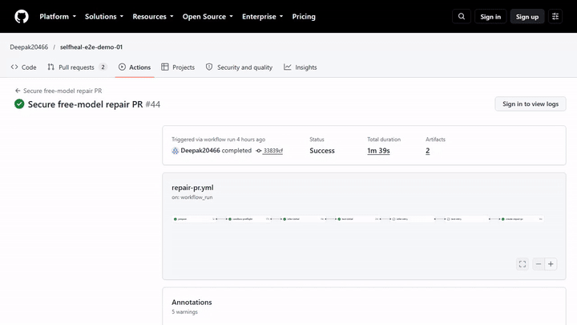
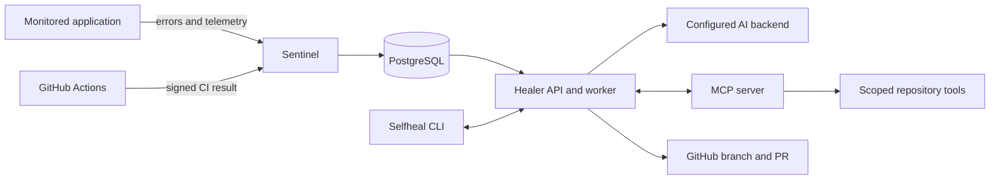

# Selfheal

AI-assisted repair for runtime and CI failures, with verified, isolated fixes and human-reviewable GitHub pull requests. **Three of three controlled end-to-end repair trials passed (2026-10-20).**

[](https://github.com/Deepak20466/selfheal-mcp-agent/actions/workflows/ci.yml)

## Demonstration

[](docs/demo-e2e-repairs.mp4)

**2:13 live-browser recording:** the video follows the corrected Demo-01 repair (PR #16), Demo-02 (PR #13), and Demo-03 (PR #10) through real public GitHub workflow, diff, and passing-CI pages. Demo-01's older comment-only PR #11 was invalid, is now closed, and is excluded from the evidence. The three valid repair PRs remain open for human review; none was merged. The earlier [50-second terminal walkthrough](docs/demo-terminal.mp4) is a separate local CLI overview.

## What it does

Selfheal captures application errors and CI failures, gathers repository context through MCP tools, asks a configured AI backend for a repair, verifies the patch, and can open a pull request for human review.

- **Detect:** runtime exceptions, OpenTelemetry signals, scan findings, and failed GitHub workflows.
- **Diagnose and repair:** scoped AI agents inspect the failure and propose code plus regression tests.
- **Verify:** run the connected repository's checks in an isolated workspace before publishing a change.
- **Review:** create a branch and pull request; the service never merges AI-generated fixes.

## Technology

Python 3.11+, FastAPI, Typer/Rich, PostgreSQL, SQLAlchemy/Alembic, MCP, GitHub Actions and API, and pluggable provider adapters. Docker, Helm, and Kubernetes manifests are included; the Kubernetes path is exercised in CI. The local default runs as four native processes and needs no Docker installation. Supporting repository code and configuration also use Shell, PowerShell, and Helm's Go templates.

## My contribution

I designed and built the repair agent, MCP integration, provider adapters, patch validation and isolated test flow, GitHub Actions security boundaries, and Docker/Helm/Kubernetes deployment assets. I also ran and documented the three controlled end-to-end repair trials shown above. The repository's CI and Kubernetes checks exercise these project components.

## Architecture



The CLI, healer API, and MCP endpoint bind to loopback for local use. Only the sentinel webhook can be exposed, and only with the explicit `selfheal up --public` option. See [docs/architecture.md](docs/architecture.md) for data flow and trust boundaries.

## Verified status — 2026-10-20

**GO for the controlled, on-demand AI repair-to-PR demonstration: 3 of 3 independent public test repositories passed.** This is an evidence-backed acceptance result for the tested workflow, **not** a claim of unrestricted, continuously available or commercially certified production readiness.

| Independent trial | Secure repair workflow | Repair pull request | Passing GitHub Actions CI |
|---|---|---|---|
| Demo-01 - Gemini 3.5 Flash-Lite fixed the +1 defect | [secure repair run 39377817751](https://github.com/Deepak20466/selfheal-e2e-demo-01/actions/runs/39377817751) | [Repair PR #16](https://github.com/Deepak20466/selfheal-e2e-demo-01/pull/16) | [CI run 39377964370](https://github.com/Deepak20466/selfheal-e2e-demo-01/actions/runs/39377964370) |
| Demo-02 - Gemini 3.8 Flash | [run 39362641443](https://github.com/Deepak20466/selfheal-e2e-demo-02/actions/runs/39362641443) | [Repair PR #13](https://github.com/Deepak20466/selfheal-e2e-demo-02/pull/13) | [CI run 39362822047](https://github.com/Deepak20466/selfheal-e2e-demo-02/actions/runs/39362822047) |
| Demo-03 - Gemini 3.5 Flash-Lite | [run 39364506704](https://github.com/Deepak20466/selfheal-e2e-demo-03/actions/runs/39364506704) | [Repair PR #10](https://github.com/Deepak20466/selfheal-e2e-demo-03/pull/10) | [CI run 39364640789](https://github.com/Deepak20466/selfheal-e2e-demo-03/actions/runs/39364640789) |

All three trials exercised failed-CI detection, an actual AI-generated patch, policy and applicability validation, isolated regression testing, automated repair PR creation, and passing repair-PR CI. For Demo-01, Gemini diagnosed the off-by-one error and generated the exact `return left + right + 1` to `return left + right` repair. The seed regression passed in a Bubblewrap-isolated, secret-free job (1/1 test), then PR #16's normal CI passed. The earlier comment-only PR #11 is closed and does not count. In Demo-03, the [secure repair workflow](https://github.com/Deepak20466/selfheal-e2e-demo-03/actions/runs/39364506704) identified multiplication in place of addition, proposed a one-line `*` to `+` change, and passed four offline tests in a Bubblewrap-isolated job.

**Security and control-plane boundaries:** The GitHub Actions inference job receives the selected provider credential; the separate test job is secret-free and network-isolated with Bubblewrap; a trusted PR job verifies the patch artifact and creates review-only pull requests. Strict patch validation, repository allowlists, scoped GitHub permissions, free-provider gates, and human review before merge remain enforced. The original provider **CLI** execution gate remains fail-closed until provider-process containment is independently verified; the successfully tested workflow uses **API inference**, not uncontained CLI execution.

**Supporting verification:** The root repository [CI run 39375584341](https://github.com/Deepak20466/selfheal-mcp-agent/actions/runs/39375584341) and [Kubernetes security run 39375584345](https://github.com/Deepak20466/selfheal-mcp-agent/actions/runs/39375584345) passed after root PR #42 merged. The earlier [20/20 fixed-fixture benchmark](docs/benchmark.md) is separate, historical evidence; it is not a general reliability guarantee.

**Scope and costs:** The demonstrations used disposable public repositories with synthetic defects and no automatic merging. For Demo-01, the owner freshly confirmed Gemini Project 2's Free tier, disabled paid billing/credits, and positive Gemini 3.5 Flash-Lite quota immediately before inference; the workflow timestamped that confirmation at `2026-10-20T05:58:48Z`. The trial used Gemini only and no paid fallback. Provider APIs do not independently expose the account's billing configuration, so the overall billing ledger was not audited. API rate limits, model availability, arbitrary-repository success rates, sustained throughput, production-cluster enforcement, and production backup/recovery are **not** established by three trials. The three valid repair PRs are intentionally left open for review.

**Demo media:** The [2:13 end-to-end recording](docs/demo-e2e-repairs.mp4) captures live GitHub pages for the three verified workflows, the exact Demo-01 repair diff, the review PRs, and passing CI. The [recording guide](docs/demo-recording.md) lists the source evidence and capture boundaries. The earlier [50-second terminal walkthrough](docs/demo-terminal.mp4) covers the local CLI only.

See the [current verification report](VERIFICATION.md), [provider setup](docs/openrouter-repair.md), and [trust-boundary design](docs/architecture.md) for detailed evidence and limitations.

## Quick start

Requires Python 3.11+ and PostgreSQL 16. On Windows, run the [secure bootstrap steps](docs/operations.md#install-on-windows) to install dependencies, create local app/test databases, and apply migrations. Then:

```powershell
.\.venv\Scripts\python.exe scripts\hash_password.py
# Set ADMIN_PASSWORD_HASH and SESSION_SECRET in .env using the generated hash.
# Configure an authenticated AI_BACKEND in .env before requesting repairs.
.\.venv\Scripts\selfheal.exe up
.\.venv\Scripts\selfheal.exe login
.\.venv\Scripts\selfheal.exe status
```

Before starting, set an authenticated `AI_BACKEND` in `.env` if you plan to run repairs. Use a separate disposable test database; never point tests at production data. Keep `.env` out of Git and use a narrowly scoped GitHub token. Full setup, provider configuration, and CLI commands are in [docs/operations.md](docs/operations.md).

## Limits and safety

The tested on-demand repair-to-PR workflow has a **GO result for three controlled public fixtures**. It is not a certification for unattended repairs to arbitrary production repositories. AI output can fail to apply, provider rate limits and timeouts can prevent completion, and published free-tier models can change. CLI-based provider execution still fails closed without verified OS containment. Generated repair PRs require human review and are not auto-merged. Do not expose secrets or use private source with free providers unless their data-handling terms are acceptable. See [VERIFICATION.md](VERIFICATION.md), [docs/AUDIT_REPORT.md](docs/AUDIT_REPORT.md), and [docs/architecture.md](docs/architecture.md).

## Documentation

- [Local installation and operations](docs/operations.md)
- [Architecture and security boundaries](docs/architecture.md)
- [Connect an application](docs/onboarding.md)
- [Demo recording guide](docs/demo-recording.md)
- [Benchmark method and results](docs/benchmark.md)
- [Verification report](VERIFICATION.md)
- [MIT License](LICENSE)
