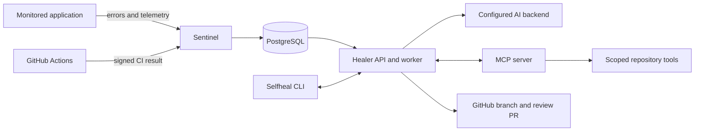

# Selfheal

Selfheal captures runtime and CI failures and proposes fixes through an AI-assisted repair worker.
It gathers repository context through MCP tools and checks candidate changes in an isolated worktree.
Server-side path rules and patch checks constrain which files a repair can change.
When verification passes, Selfheal can open a GitHub pull request for a person to review.
The project includes a native-process demo, a mined historical-bug benchmark, and deployment examples.

## Real historical bug benchmark

Only provider attempts recorded by `benchmarks/real_bugs/run.py` belong in this table. Fixture and
synthetic demo results are reported separately under [Smoke tests](#smoke-tests).

| Run | Provider / model | Validation arm | Cases | Resolve rate | Resolve + full suite | False-positive proxy | Median time | Median reported cost |
|---|---|---|---:|---:|---:|---:|---:|---:|
| No completed provider run in this workspace | n/a | n/a | 0 | n/a | n/a | n/a | n/a | n/a |

The real-bug cases must first be mined and prepared locally; preparation is not a repair result.
Reproduction instructions and the benchmark's current data status are in
[docs/benchmark-real-bugs.md](docs/benchmark-real-bugs.md).

## Where it fails

The historical-bug benchmark has not completed an AI provider run here, so it has no measured
repair rate or failure distribution yet. The scorer records failures as `no_patch`, `invalid_patch`,
`rejected_by_policy`, `tests_still_failing`, `timeout`, `provider_error`, `token_cap`, `cost_cap`,
`cost_unknown`, or `repair_error`; missing costs remain unknown. The no-policy ablation bypasses
Selfheal's patch policy while retaining the OS sandbox for untrusted repository tests.

The current evidence does not measure sustained operation, arbitrary repositories, production
traffic, provider availability, or recovery from production backups. Test and API-backed demo results
do not establish kernel-level sandbox escape resistance. Pull requests remain for human review; the
system does not merge them automatically. See [VERIFICATION.md](VERIFICATION.md) for dated evidence
and gaps.

## Smoke tests

- **Controlled synthetic repair trials:** three independent public fixtures previously completed
the repair-to-PR flow and their PR CI passed. These used synthetic defects, not mined historical
bugs: [demo 01 PR #16](https://github.com/Deepak20466/selfheal-e2e-demo-01/pull/16),
[demo 02 PR #13](https://github.com/Deepak20466/selfheal-e2e-demo-02/pull/13), and
[demo 03 PR #10](https://github.com/Deepak20466/selfheal-e2e-demo-03/pull/10). The earlier
comment-only demo 01 PR #11 is excluded.
- **Fixed-fixture benchmark:** a separate historical run reported 20/20 synthetic scenarios
repaired. It used the Codex CLI before the provider CLI fail-closed gate; it is not evidence for
the new real-bug benchmark. Details: [docs/benchmark.md](docs/benchmark.md).
- **Runtime error demo:** three intentional defects can be triggered in
[examples/runtime_demo](examples/runtime_demo). Native launch scripts are provided for Bash and
PowerShell. A PR is reported only if the worker actually opens one.

## Architecture



Selfheal uses Python 3.11+, FastAPI, Typer, PostgreSQL, SQLAlchemy/Alembic, MCP, and GitHub APIs.
The local path runs as native processes and does not require Docker. Docker and Kubernetes deployment
assets are separate options. See [docs/architecture.md](docs/architecture.md) for trust boundaries.

## Quick start

Requires Python 3.11+ and PostgreSQL 16. On Windows, follow the
[native installation steps](docs/operations.md#install-on-windows). Then configure `.env` and run:

```powershell
.\.venv\Scripts\python.exe scripts\hash_password.py
# Set ADMIN_PASSWORD_HASH and SESSION_SECRET in .env using the generated hash.
# Configure a supported AI_BACKEND before requesting repairs.
.\.venv\Scripts\selfheal.exe up
.\.venv\Scripts\selfheal.exe login
.\.venv\Scripts\selfheal.exe status
```

For a disposable test database and required development settings, see
[docs/operations.md](docs/operations.md). Keep `.env` out of Git and use narrowly scoped GitHub
credentials.

## Documentation

- [Local installation and operations](docs/operations.md)
- [Architecture and security boundaries](docs/architecture.md)
- [Connect an application](docs/onboarding.md)
- [Runtime error demo](examples/runtime_demo/README.md)
- [Historical bug benchmark method](docs/benchmark-real-bugs.md)
- [Historical fixture benchmark](docs/benchmark.md)
- [Verification report](VERIFICATION.md)
- [Changelog](CHANGELOG.md)
- [MIT License](LICENSE)
