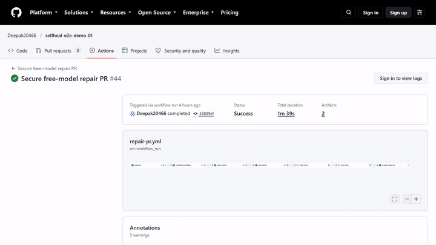
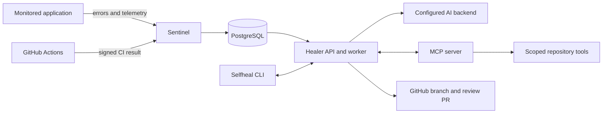

# SelfHeal MCP Agent

AI-powered incident-to-patch automation with scoped MCP repository tools, policy-checked diffs,
isolated tests, and human-reviewed pull requests.

[](https://github.com/Deepak20466/selfheal-mcp-agent/actions/workflows/ci.yml?query=branch%3Afeat%2Fgemini-benchmark-route)
[](https://github.com/Deepak20466/selfheal-mcp-agent/actions/workflows/k8s-ci.yml?query=branch%3Afeat%2Fgemini-benchmark-route)



[Synthetic repair-to-PR walkthrough](docs/demo-e2e-repairs.mp4) ·
[VIMJ single-case repair demo (1080p, 2:08)](https://github.com/Deepak20466/selfheal-mcp-agent/releases/download/portfolio-demo-vimj-2026-11-10/selfheal-mcp-agent-demo.mp4) ·
[Terminal walkthrough](docs/demo-terminal.mp4)

Python 3.11+ · FastAPI · PostgreSQL · SQLAlchemy/Alembic · MCP · Typer · GitHub Actions

## Quick start

The CLI help runs without a database or provider credentials:

```powershell
python -m cli.main --help
```

For native PostgreSQL setup, local services, and credentials needed to run repairs, follow
[Local installation and operations](docs/operations.md). Keep local environment files out of Git.

## Providers and MCP tools

The repair loop supports Claude, Codex, and Gemini CLI backends; Anthropic-compatible API,
OpenRouter, Gemini API, and Groq API adapters; and explicitly configured backend chains. Availability
depends on operator credentials, model access, and quota. Benchmark commands select one frozen
provider and do not fall back to another. The repository MCP surface includes error lookup, scoped
file listing/reading, patch proposal, and sandboxed test execution. See [backend selection](docs/operations.md)
and [security boundaries](docs/architecture.md).

## Benchmarks & Real-World Evaluation

### Verified outcomes

| Evaluation | Result | Scope and evidence |
|---|---|---|
| Synthetic repair benchmark | **20/20 diagnoses and 20/20 repairs verified**; 0 terminal false fixes; 0 manual interventions. One case used a retry (21 model generations total); mean repair and verification time was 15.8649s. | Historical Codex CLI run on 20 seeded failures in one synthetic FastAPI repository; [full method, per-case results, and limitations](docs/benchmark.md); [raw run](benchmarks/results/codex-full-2026-10-19-run5.json). |
| VIMJ fee-balance offline recovery case | On the frozen baseline, the saved isolated regression passed **1 test** and the saved backend suite passed **30 tests** after applying the preserved AI-authored code hunk. | This is a limited offline case study at VIMJ commit [`6490833`](https://github.com/Deepak20466/vimj-studio-os-saas/commit/6490833d178b71624d024b16046240a20a3f78a6), not a successful live autonomous SelfHeal repair. The OpenRouter response failed SelfHeal's patch-format gate; a later OpenRouter attempt returned no usable patch (`no_patch`). The AI hunk was recovered with formatting-only diff normalization before the saved tests. No VIMJ PR or merge was created. [Evidence, patch, saved outcomes, and reproduction steps](docs/evidence/vimj-fee-balance-2026-11-10.md). |
| Synthetic repair-to-PR demos | Three controlled repairs reached CI-passing PRs. | Demo repos: [#16, merged](https://github.com/Deepak20466/selfheal-e2e-demo-01/pull/16), [#13, open](https://github.com/Deepak20466/selfheal-e2e-demo-02/pull/13), [#10, open](https://github.com/Deepak20466/selfheal-e2e-demo-03/pull/10). |

The synthetic 20/20 result is a fixed-fixture historical benchmark, not an estimate of performance
on arbitrary repositories or current production reliability. The VIMJ result is one isolated
offline recovery case: it does not establish a successful live autonomous repair, corpus score, or
end-to-end hosted repair-to-PR run. Aggregate performance across the 41-case real-bug corpus
remains unmeasured.

### Gemini real-bug pilot: incomplete, no repair completed

The predetermined 10-case pilot has **5 saved attempt records, 0 completed repairs, and 8 cases
not attempted**. Two requests timed out at Gemini `generateContent`; three were rejected with HTTP
400 because function-call history omitted Gemini's signed Parts / `thoughtSignature` protocol data.
Therefore, **0/5 means no attempt completed a repair; it does not mean five generated patches were
validated and found incorrect**. No full suite passed. The saved scorer reports 0/5 resolve and
0/5 full-suite-green resolves, 121.094s median elapsed time, 6,989 reported tokens, and unknown
cost for all five attempts. Failure labels were `provider_error` (2) and `repair_error` (3).

See the [benchmark method and pilot details](docs/benchmark-real-bugs.md), [readable saved results](benchmarks/real_bugs/results/published/pilot-through-v8.md),
[scorer JSON](benchmarks/real_bugs/results/published/pilot-through-v8.json), and
[five-record JSONL source](benchmarks/real_bugs/results/published/gemini-v5-v8-attempts.jsonl).
The adapter fix is covered offline; it has not been verified by a live Gemini rerun.

### Other real-world evidence and limits

Engineer-directed dogfooding exposed two Selfheal defects, fixed in commits
[`ecba78b`](https://github.com/Deepak20466/selfheal-mcp-agent/commit/ecba78b90773d965d5218dce5688fb9cef6ef503)
and [`c402003`](https://github.com/Deepak20466/selfheal-mcp-agent/commit/c402003ea41b7e2d8e5283a8954519e412c314d6).
The PyPDF2 repair did not converge. In ShopCart, onboarding PR [#1](https://github.com/Deepak20466/ShopCart/pull/1)
needed manual setup repair; pagination was fixed manually in PR [#2](https://github.com/Deepak20466/ShopCart/pull/2),
and clean-build and dependency work landed in PRs [#3](https://github.com/Deepak20466/ShopCart/pull/3)
and [#4](https://github.com/Deepak20466/ShopCart/pull/4). PR #4 reduced audit findings from 36
(5 critical, 17 high, 14 moderate) to 20 (3 critical, 7 high, 10 moderate). These were not
Selfheal-generated bug repairs. Dated outcomes and the broader evidence ledger remain in
[VERIFICATION.md](VERIFICATION.md) and the [recovered evidence ledger](docs/history/RECOVERED_EVIDENCE.md).

### Other provider evaluations

Separate GroqCloud diagnostics completed no repairs: v1/v2 recorded TPM and request-length errors;
v3 made one successful API call, then stopped locally when its prompt estimate exceeded the remaining
TPM budget. V4 has not been run. The separate frozen VIMJ Groq evaluation also completed no repair;
its current Gemini route has offline test coverage but no live attempt. Full configurations, exact
attempt records, and limits are in the [real-bug benchmark report](docs/benchmark-real-bugs.md),
[Groq runbook](docs/groqcloud-repair.md), and [VIMJ evaluation record](docs/unresolved-bug-evaluation.md).

## Manually reported bugs

For logic bugs or untested repositories that no scanner category detects, record a human finding
with `selfheal report-bug --repo owner/repo --file src/app.py --description "Off-by-one on page 1"`,
then use `selfheal fix owner/repo <finding-id> --suggest`; this path always opens an UNVERIFIED,
human-review-only suggestion and cannot claim the normal verified route. See
[manual bug reporting](docs/manual-bug-reports.md).

## Architecture



## Evidence and limitations

### Where it fails

The PyPDF2 repair did not converge, so no fix to that issue is claimed. ShopCart's pagination bug
was fixed manually (engineer-directed, Claude-assisted) in PR #2, not by Selfheal's repair loop.
Earlier seeded trials also include failed AI repair attempts and CI checks; the evidence ledger
links each result rather than counting only successful attempts.
The five saved Gemini attempt records have a 0/5 resolve rate and 0/5 full-suite-green resolve rate;
no repair completed. False-positive rate is not measurable (zero eligible human-fix denominator),
and cost is unknown for every attempt. Their overall median time is 121.094s. Failure categories
are `provider_error` (2) and `repair_error` (3). Eight selected bugs and the full 41-case run remain
unattempted. The scorer's failure categories are `no_patch`, `invalid_patch`,
`rejected_by_policy`, `tests_still_failing`, `timeout`, `provider_error`, `token_cap`, `cost_cap`,
`cost_unknown`, and `repair_error`; these are labels in the harness, not measured frequencies.
The v5/v7 timeouts occurred during Gemini `generateContent`, not MCP. The v8 HTTP 400 records show
Gemini rejected function-call history because the adapter dropped original signed Parts and sent
incorrect function-response names/IDs. v9 returns the original Parts and maps responses back to
their calls; offline regression coverage includes the `run_tests` rejection and multiple calls.
No live verification of this fix has been made. See the [partial results](benchmarks/real_bugs/results/published/pilot-through-v8.md)
and [Gemini adapter tests](tests/test_healer_api_adapters.py).

The separate Groq v3 diagnostic made one successful provider call, then stopped locally at the
6,818-estimated / 5,936-remaining TPM boundary; it made no repair. V4 adds an offline-tested bounded
wait using the server reset header and passes all three leakage audits, but has not been run. The
original Groq 10-case pilot remains unattempted. See the [Groq result and limits](docs/groqcloud-repair.md).

The no-policy ablation bypasses Selfheal's patch policy but still uses the OS sandbox for untrusted
repository tests. Pull requests are review artifacts; this evidence does not claim that tests alone
prove every change correct or establish merge-policy behavior. The records do not count a passing
test as a deployed change.

### Threats to validity

Historical synthetic trials used controlled defects and a small number of repositories; they do not
estimate performance on arbitrary repositories. The 20-case Codex fixture result used one synthetic
FastAPI repository, while the three later repair-to-PR demos used synthetic defects. The real-repo
evidence is a small set of engineer-selected tasks and does not establish sustained operation,
provider availability under prolonged rate limits, behavior on production traffic, or backup
recovery. Tests and API-backed demos do not establish kernel-level sandbox escape resistance.
Historical Claude Code costs are subscription-usage records, not API billing measurements. Provider
prices and quotas can change; the provider API could not attest the earlier free-tier account's full
billing state. The available evidence does not include an independent review of that billing
ledger. The VIMJ fee-balance repair was local and isolated; it created no VIMJ PR or hosted repair
workflow. No remote SelfHeal run was found for either Attendance Academy repository in the reviewed
session logs, PRs, or Actions records. VIMJ PR #1 is a separate Codex-assisted password-reset fix.

For complete dated results and limitations, see [VERIFICATION.md](VERIFICATION.md),
[the evidence ledger](docs/history/RECOVERED_EVIDENCE.md), and the separate
[synthetic fixture benchmark](docs/benchmark.md). The retired browser UI screenshots and video are
kept under [legacy-web-ui-demo](docs/history/legacy-web-ui-demo/README.md); they do not show the
current terminal-first product.

## Documentation

- [Local installation and operations](docs/operations.md)
- [Architecture and security boundaries](docs/architecture.md)
- [Connect an application](docs/onboarding.md)
- [Runtime error demo](examples/runtime_demo/README.md)
- [Three-minute interview walkthrough](docs/interview-demo.md)
- [Real-bug benchmark method](docs/benchmark-real-bugs.md)
- [Verified VIMJ single-case evidence](docs/evidence/vimj-fee-balance-2026-11-10.md)
- [Historical fixture benchmark](docs/benchmark.md)
- [Verification report](VERIFICATION.md)
- [Recovered evidence](docs/history/RECOVERED_EVIDENCE.md)
- [GitHub profile kit](docs/github-profile-kit.md)
- [Changelog](CHANGELOG.md)
- [MIT License](LICENSE)
