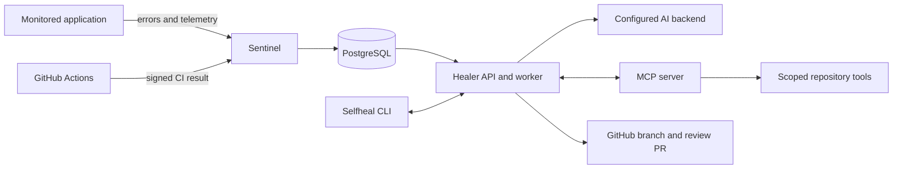

# SelfHeal MCP Agent

AI-powered incident-to-patch automation with scoped MCP repository tools, policy-checked diffs,
isolated tests, and human-reviewed pull requests.


[Synthetic repair-to-PR walkthrough](docs/demo-e2e-repairs.mp4) ·
[VIMJ single-case repair demo (1080p, 2:08)](https://github.com/Deepak20466/selfheal-mcp-agent/releases/download/portfolio-demo-vimj-2026-11-10/selfheal-mcp-agent-demo.mp4) ·
[Terminal walkthrough](docs/demo-terminal.mp4)

Python 3.11+ · FastAPI · PostgreSQL · SQLAlchemy/Alembic · MCP · Typer · GitHub Actions

## Quick start

The CLI help runs without a database or provider credentials:

```powershell
python -m cli.main --help
```

For native PostgreSQL setup, local services, and credentials needed to run repairs, follow
[Local installation and operations](docs/operations.md). Keep local environment files out of Git.

## Tested on

| Repository | Classification | Verified scope and current outcome |
|---|---|---|
| [`selfheal-e2e-demo-01`](https://github.com/Deepak20466/selfheal-e2e-demo-01) | Synthetic, AI-generated repair | Controlled repair-to-PR trial; PR [#16](https://github.com/Deepak20466/selfheal-e2e-demo-01/pull/16) and CI passed; PR #16 is merged. |
| [`selfheal-e2e-demo-02`](https://github.com/Deepak20466/selfheal-e2e-demo-02) | Synthetic, AI-generated repair | Controlled repair-to-PR trial; PR [#13](https://github.com/Deepak20466/selfheal-e2e-demo-02/pull/13) and CI passed; PR #13 remains open. |
| [`selfheal-e2e-demo-03`](https://github.com/Deepak20466/selfheal-e2e-demo-03) | Synthetic, AI-generated repair | Controlled repair-to-PR trial; PR [#10](https://github.com/Deepak20466/selfheal-e2e-demo-03/pull/10) and CI passed; PR #10 remains open. |
| [`multi-agent-workspace`](https://github.com/Deepak20466/multi-agent-workspace) | Manual, engineer-directed and Claude-assisted | Dogfooding exposed two Selfheal defects, fixed in Selfheal commits [`ecba78b`](https://github.com/Deepak20466/selfheal-mcp-agent/commit/ecba78b90773d965d5218dce5688fb9cef6ef503) and [`c402003`](https://github.com/Deepak20466/selfheal-mcp-agent/commit/c402003ea41b7e2d8e5283a8954519e412c314d6). The PyPDF2 repair did not converge; a separate manual PR [#1](https://github.com/Deepak20466/multi-agent-workspace/pull/1) merged despite unrelated failing CI. |
| [ShopCart](https://github.com/Deepak20466/ShopCart) | Manual changes; AI-prepared onboarding | Selfheal onboarding PR [#1](https://github.com/Deepak20466/ShopCart/pull/1) needed manual setup repair before CI ran. The pagination bug was fixed manually (engineer-directed, Claude-assisted) in PR [#2](https://github.com/Deepak20466/ShopCart/pull/2); clean-build work was PR [#3](https://github.com/Deepak20466/ShopCart/pull/3); safe dependency updates were PR [#4](https://github.com/Deepak20466/ShopCart/pull/4). All four are merged. PR #4 reduced audit findings from 36 (5 critical, 17 high, 14 moderate) to 20 (3 critical, 7 high, 10 moderate). |
| [`vimj-studio-os-saas`](https://github.com/Deepak20466/vimj-studio-os-saas) | Manual GitHub search; separate isolated local case | No remote run appears in the reviewed PR, issue, and Actions listings. A separate local VIMJ fee-balance repair is documented [here](docs/evidence/vimj-fee-balance-2026-11-10.md); it did not create a VIMJ PR. |
| [`attendance-academy-go-flutter`](https://github.com/Deepak20466/attendance-academy-go-flutter) | Manual GitHub search | No Selfheal run recorded in the reviewed PR, issue, and Actions listings. |
| [`attendance-academy-management-system`](https://github.com/Deepak20466/attendance-academy-management-system) | Manual GitHub search | No Selfheal run recorded in the reviewed PR, issue, and Actions listings. |

## Manually reported bugs

For logic bugs or untested repositories that no scanner category detects, record a human finding
with `selfheal report-bug --repo owner/repo --file src/app.py --description "Off-by-one on page 1"`,
then use `selfheal fix owner/repo <finding-id> --suggest`; this path always opens an UNVERIFIED,
human-review-only suggestion and cannot claim the normal verified route. See
[manual bug reporting](docs/manual-bug-reports.md).

## Real-world dogfooding

Engineer-directed, Claude-assisted dogfooding against `multi-agent-workspace` exposed two bugs in
Selfheal itself: dependency-audit findings were dropped when stderr corrupted JSON, and an
uncaught remote-verification exception could stop the worker. Both fixes have regression tests in
[`ecba78b`](https://github.com/Deepak20466/selfheal-mcp-agent/commit/ecba78b90773d965d5218dce5688fb9cef6ef503)
and [`c402003`](https://github.com/Deepak20466/selfheal-mcp-agent/commit/c402003ea41b7e2d8e5283a8954519e412c314d6).
They were not produced by Selfheal's repair loop. The PyPDF2 repair attempt did not converge; a
separate manual dependency PR [#1](https://github.com/Deepak20466/multi-agent-workspace/pull/1)
merged even though its required CI failed in an unrelated setup step.

ShopCart's onboarding PR [#1](https://github.com/Deepak20466/ShopCart/pull/1) was opened by
Selfheal's `selfheal prepare` flow but needed manual repair commit
[`b758bb1`](https://github.com/Deepak20466/ShopCart/commit/b758bb18dddefa67ec6bf9d69784135149fae035)
before CI could run: the workflow was nested, Vitest was unpinned and incompatible with the
project's Vite 4 line, and test imports used paths absent from the repository. The pagination bug
was found manually and fixed manually (engineer-directed, Claude-assisted) in ShopCart PR
[#2](https://github.com/Deepak20466/ShopCart/pull/2); this was not a Selfheal-generated repair.

Separately, one authorized free-tier OpenRouter response produced a patch for a frozen VIMJ
fee-balance regression. Formatting-only normalization made the returned code hunk valid for the
patch validator; the saved regression and VIMJ backend logs report 1 and 30 passing tests. This was
an isolated single-case repair, not a complete autonomous repair-to-PR run. See the
[VIMJ evidence report](docs/evidence/vimj-fee-balance-2026-11-10.md).

The dated outcomes and evidence links are in [VERIFICATION.md](VERIFICATION.md) and the
[recovered evidence ledger](docs/history/RECOVERED_EVIDENCE.md).

## Real-bug benchmark status

**Corpus benchmark:** the harness is included, but aggregate results across the mined real-bug case
set remain unmeasured. A separate VIMJ single-case repair and backend test result are recorded in
the [evidence report](docs/evidence/vimj-fee-balance-2026-11-10.md); these are not corpus benchmark
metrics or a repair-to-PR demonstration.

## Architecture



## Evidence and limitations

### Where it fails

The PyPDF2 repair did not converge, so no fix to that issue is claimed. ShopCart's pagination bug
was fixed manually (engineer-directed, Claude-assisted) in PR #2, not by Selfheal's repair loop.
Earlier seeded trials also include failed AI repair attempts and CI checks; the evidence ledger
links each result rather than counting only successful attempts.
One VIMJ provider repair has completed, but no aggregate provider run from the mined-case benchmark
harness is recorded. Corpus resolve rates, full-suite resolve rates, false-positive rate, median
time, median cost, and failure distribution remain unknown. The scorer's failure categories are
`no_patch`, `invalid_patch`,
`rejected_by_policy`, `tests_still_failing`, `timeout`, `provider_error`, `token_cap`, `cost_cap`,
`cost_unknown`, and `repair_error`; these are labels in the harness, not measured frequencies.

The no-policy ablation bypasses Selfheal's patch policy but still uses the OS sandbox for untrusted
repository tests. Pull requests are review artifacts; this evidence does not claim that tests alone
prove every change correct or establish merge-policy behavior. The records do not count a passing
test as a deployed change.

### Threats to validity

Historical synthetic trials used controlled defects and a small number of repositories; they do not
estimate performance on arbitrary repositories. The 20-case Codex fixture result used one synthetic
FastAPI repository, while the three later repair-to-PR demos used synthetic defects. The real-repo
evidence is a small set of engineer-selected tasks and does not establish sustained operation,
provider availability under prolonged rate limits, behavior on production traffic, or backup
recovery. Tests and API-backed demos do not establish kernel-level sandbox escape resistance.
Historical Claude Code costs are subscription-usage records, not API billing measurements. Provider
prices and quotas can change; the provider API could not attest the earlier free-tier account's full
billing state. The available evidence does not include an independent review of that billing
ledger. The VIMJ single-case result is local and isolated; no VIMJ PR or hosted repair workflow is
claimed. No remote Selfheal run was found for either Attendance Academy repository in the reviewed
session logs, PRs, or Actions records.

For complete dated results and limitations, see [VERIFICATION.md](VERIFICATION.md),
[the evidence ledger](docs/history/RECOVERED_EVIDENCE.md), and the separate
[synthetic fixture benchmark](docs/benchmark.md). The retired browser UI screenshots and video are
kept under [legacy-web-ui-demo](docs/history/legacy-web-ui-demo/README.md); they do not show the
current terminal-first product.

## Documentation

- [Local installation and operations](docs/operations.md)
- [Architecture and security boundaries](docs/architecture.md)
- [Connect an application](docs/onboarding.md)
- [Runtime error demo](examples/runtime_demo/README.md)
- [Real-bug benchmark method](docs/benchmark-real-bugs.md)
- [Verified VIMJ single-case evidence](docs/evidence/vimj-fee-balance-2026-11-10.md)
- [Historical fixture benchmark](docs/benchmark.md)
- [Verification report](VERIFICATION.md)
- [Recovered evidence](docs/history/RECOVERED_EVIDENCE.md)
- [GitHub profile kit](docs/github-profile-kit.md)
- [Changelog](CHANGELOG.md)
- [MIT License](LICENSE)
