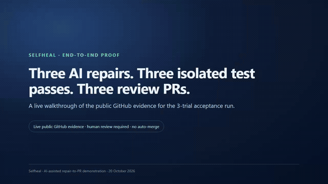
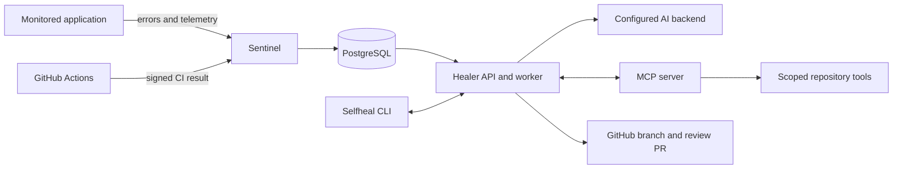

# SelfHeal MCP Agent

AI-powered incident-to-patch automation with scoped MCP repository tools, policy-checked diffs,
isolated tests, and human-reviewed pull requests.

[](https://github.com/Deepak20466/selfheal-mcp-agent/actions/workflows/ci.yml?query=branch%3Afeat%2Fgemini-benchmark-route)
[](https://github.com/Deepak20466/selfheal-mcp-agent/actions/workflows/k8s-ci.yml?query=branch%3Afeat%2Fgemini-benchmark-route)



[Controlled synthetic repair-to-PR walkthrough (2:13)](docs/demo-e2e-repairs-portfolio-2026-11-10.mp4) ·
[VIMJ isolated repair demo (1080p, 1:52)](https://github.com/Deepak20466/selfheal-mcp-agent/releases/download/portfolio-demo-vimj-2026-11-10/selfheal-mcp-agent-demo-2026-11-10-v2.mp4) ·
[Terminal walkthrough](docs/demo-terminal.mp4)

Python 3.11+ · FastAPI · PostgreSQL · SQLAlchemy/Alembic · MCP · Typer · GitHub Actions

## Quick start

The CLI help runs without a database or provider credentials:

```powershell
python -m cli.main --help
```

For native PostgreSQL setup, local services, and credentials needed to run repairs, follow
[Local installation and operations](docs/operations.md). Keep local environment files out of Git.

## Providers and MCP tools

The repair loop supports Claude, Codex, and Gemini CLI backends; Anthropic-compatible API,
OpenRouter, Gemini API, and Groq API adapters; and explicitly configured backend chains. Availability
depends on operator credentials, model access, and quota. Benchmark commands select one frozen
provider and do not fall back to another. The repository MCP surface includes error lookup, scoped
file listing/reading, patch proposal, and sandboxed test execution. See [backend selection](docs/operations.md)
and [security boundaries](docs/architecture.md).

## Demonstrations & Verified Results

| Repository | Classification | Verified scope and current outcome |
|---|---|---|
| [`selfheal-e2e-demo-01`](https://github.com/Deepak20466/selfheal-e2e-demo-01) | Synthetic, AI-generated repair | Controlled repair-to-PR trial; PR [#16](https://github.com/Deepak20466/selfheal-e2e-demo-01/pull/16) and CI passed; PR #16 is merged. |
| [`selfheal-e2e-demo-02`](https://github.com/Deepak20466/selfheal-e2e-demo-02) | Synthetic, AI-generated repair | Controlled repair-to-PR trial; PR [#13](https://github.com/Deepak20466/selfheal-e2e-demo-02/pull/13) and CI passed; PR #13 remains open. |
| [`selfheal-e2e-demo-03`](https://github.com/Deepak20466/selfheal-e2e-demo-03) | Synthetic, AI-generated repair | Controlled repair-to-PR trial; PR [#10](https://github.com/Deepak20466/selfheal-e2e-demo-03/pull/10) and CI passed; PR #10 remains open. |
| [`multi-agent-workspace`](https://github.com/Deepak20466/multi-agent-workspace) | Manual, engineer-directed and Claude-assisted | Dogfooding exposed two Selfheal defects, fixed in Selfheal commits [`ecba78b`](https://github.com/Deepak20466/selfheal-mcp-agent/commit/ecba78b90773d965d5218dce5688fb9cef6ef503) and [`c402003`](https://github.com/Deepak20466/selfheal-mcp-agent/commit/c402003ea41b7e2d8e5283a8954519e412c314d6). The PyPDF2 repair did not converge; a separate manual PR [#1](https://github.com/Deepak20466/multi-agent-workspace/pull/1) merged despite unrelated failing CI. |
| [ShopCart](https://github.com/Deepak20466/ShopCart) | Manual changes; AI-prepared onboarding | Selfheal onboarding PR [#1](https://github.com/Deepak20466/ShopCart/pull/1) needed manual setup repair before CI ran. The pagination bug was fixed manually (engineer-directed, Claude-assisted) in PR [#2](https://github.com/Deepak20466/ShopCart/pull/2); clean-build work was PR [#3](https://github.com/Deepak20466/ShopCart/pull/3); safe dependency updates were PR [#4](https://github.com/Deepak20466/ShopCart/pull/4). All four are merged. PR #4 reduced audit findings from 36 (5 critical, 17 high, 14 moderate) to 20 (3 critical, 7 high, 10 moderate). |
| [`vimj-studio-os-saas`](https://github.com/Deepak20466/vimj-studio-os-saas) | Isolated real-application repair; AI-generated code | At frozen commit [`6490833`](https://github.com/Deepak20466/vimj-studio-os-saas/commit/6490833d178b71624d024b16046240a20a3f78a6), the unpaid balance was ₹125; expected ₹175. One genuine AI-generated repair required patch metadata normalization. Saved local logs report the frozen regression **1 passed** and complete backend suite **30 passed**. No VIMJ PR or merge was created. [Evidence](docs/evidence/vimj-fee-balance-2026-11-10.md). |

## Manually reported bugs

For logic bugs or untested repositories that no scanner category detects, record a human finding
with `selfheal report-bug --repo owner/repo --file src/app.py --description "Off-by-one on page 1"`,
then use `selfheal fix owner/repo <finding-id> --suggest`; this path always opens an UNVERIFIED,
human-review-only suggestion and cannot claim the normal verified route. See
[manual bug reporting](docs/manual-bug-reports.md).

## Real-world dogfooding

Engineer-directed, Claude-assisted dogfooding against `multi-agent-workspace` exposed two bugs in
Selfheal itself: dependency-audit findings were dropped when stderr corrupted JSON, and an
uncaught remote-verification exception could stop the worker. Both fixes have regression tests in
[`ecba78b`](https://github.com/Deepak20466/selfheal-mcp-agent/commit/ecba78b90773d965d5218dce5688fb9cef6ef503)
and [`c402003`](https://github.com/Deepak20466/selfheal-mcp-agent/commit/c402003ea41b7e2d8e5283a8954519e412c314d6).
They were not produced by Selfheal's repair loop. The PyPDF2 repair attempt did not converge; a
separate manual dependency PR [#1](https://github.com/Deepak20466/multi-agent-workspace/pull/1)
merged even though its required CI failed in an unrelated setup step.

ShopCart's onboarding PR [#1](https://github.com/Deepak20466/ShopCart/pull/1) was opened by
Selfheal's `selfheal prepare` flow but needed manual repair commit
[`b758bb1`](https://github.com/Deepak20466/ShopCart/commit/b758bb18dddefa67ec6bf9d69784135149fae035)
before CI could run: the workflow was nested, Vitest was unpinned and incompatible with the
project's Vite 4 line, and test imports used paths absent from the repository. The pagination bug
was found manually and fixed manually (engineer-directed, Claude-assisted) in ShopCart PR
[#2](https://github.com/Deepak20466/ShopCart/pull/2); this was not a Selfheal-generated repair.

The dated outcomes and evidence links are in [VERIFICATION.md](VERIFICATION.md) and the
[recovered evidence ledger](docs/history/RECOVERED_EVIDENCE.md).

## Real-bug benchmark status

The mined Gemini benchmark's predetermined 10-case pilot remains incomplete. Five attempt records across
v5, v7, and v8 cover two selected bugs; two v5/v7 requests timed out, and three v8 requests failed
with Gemini HTTP 400 because conversation history omitted thought signatures for function calls.
No pilot repair completed; eight selected cases remain unattempted. v9 preserves the original cohort and
pilot IDs and fixes Gemini Part/function-response round-tripping. See the [real-bug benchmark
report](docs/benchmark-real-bugs.md) and [saved partial results](benchmarks/real_bugs/results/published/pilot-through-v8.md).
The historical fixture benchmark remains separate.

GroqCloud is available through the existing OpenAI-compatible adapter. Its preserved v1/v2
diagnostics recorded a TPM 429 and a request-length HTTP 400; neither completed a repair. The v3
diagnostic made one successful API call (1,505 input and 89 output tokens), then stopped locally
when its 6,818-token prompt estimate exceeded 5,936 remaining TPM. It made no second request and
completed no repair. Frozen v4 can wait once for the server's token-reset header only when the
history can fit a fresh 8,000-token window and the request deadline allows it; its full, pilot, and
diagnostic leakage audits pass. No v4 provider run has occurred. See the [Groq repair runbook](docs/groqcloud-repair.md).

The separate frozen VIMJ fee-balance evaluation retains two Groq attempts. The first exposed and
fixed a Selfheal MCP tracer recursion bug (commit `0c1f8c3`). The second stopped before a second
request at the local TPM budget; no repair completed. The separately versioned current route uses
Gemini 2.5 Flash through the existing `GeminiApiClient`. It preserves the frozen VIMJ baseline and
regression, exact source allowlist, 32,768-token budget, 10-request cap, 600-second timeout, and $0
free-only requirement. Historical Cohere/OpenRouter and Groq evidence remains unchanged. Mocked
offline tests exercise the Gemini MCP patch workflow; no live Gemini attempt or autonomous repair
result is claimed. See the [VIMJ evaluation record](docs/unresolved-bug-evaluation.md).

The completed isolated fee-balance repair in the results table is separate from these benchmark
attempts and is not an aggregate benchmark result. Aggregate performance across the 41-case corpus
remains unmeasured; the pilot and single-case results are not general success rates.

## Architecture



## Evidence and limitations

### Where it fails

The PyPDF2 repair did not converge, so no fix to that issue is claimed. ShopCart's pagination bug
was fixed manually (engineer-directed, Claude-assisted) in PR #2, not by Selfheal's repair loop.
Earlier seeded trials also include failed AI repair attempts and CI checks; the evidence ledger
links each result rather than counting only successful attempts.
The five saved Gemini attempt records have a 0/5 resolve rate and 0/5 full-suite-green resolve rate;
no repair completed. False-positive rate is not measurable (zero eligible human-fix denominator),
and cost is unknown for every attempt. Their overall median time is 121.094s. Failure categories
are `provider_error` (2) and `repair_error` (3). Eight selected bugs and the full 41-case run remain
unattempted. The scorer's failure categories are `no_patch`, `invalid_patch`,
`rejected_by_policy`, `tests_still_failing`, `timeout`, `provider_error`, `token_cap`, `cost_cap`,
`cost_unknown`, and `repair_error`; these are labels in the harness, not measured frequencies.
The v5/v7 timeouts occurred during Gemini `generateContent`, not MCP. The v8 HTTP 400 records show
Gemini rejected function-call history because the adapter dropped original signed Parts and sent
incorrect function-response names/IDs. v9 returns the original Parts and maps responses back to
their calls; offline regression coverage includes the `run_tests` rejection and multiple calls.
No live verification of this fix has been made. See the [partial results](benchmarks/real_bugs/results/published/pilot-through-v8.md)
and [Gemini adapter tests](tests/test_healer_api_adapters.py).

The separate Groq v3 diagnostic made one successful provider call, then stopped locally at the
6,818-estimated / 5,936-remaining TPM boundary; it made no repair. V4 adds an offline-tested bounded
wait using the server reset header and passes all three leakage audits, but has not been run. The
original Groq 10-case pilot remains unattempted. See the [Groq result and limits](docs/groqcloud-repair.md).

The no-policy ablation bypasses Selfheal's patch policy but still uses the OS sandbox for untrusted
repository tests. Pull requests are review artifacts; this evidence does not claim that tests alone
prove every change correct or establish merge-policy behavior. The records do not count a passing
test as a deployed change.

### Threats to validity

Historical synthetic trials used controlled defects and a small number of repositories; they do not
estimate performance on arbitrary repositories. The 20-case Codex fixture result used one synthetic
FastAPI repository, while the three later repair-to-PR demos used synthetic defects. The real-repo
evidence is a small set of engineer-selected tasks and does not establish sustained operation,
provider availability under prolonged rate limits, behavior on production traffic, or backup
recovery. Tests and API-backed demos do not establish kernel-level sandbox escape resistance.
Historical Claude Code costs are subscription-usage records, not API billing measurements. Provider
prices and quotas can change; the provider API could not attest the earlier free-tier account's full
billing state. The available evidence does not include an independent review of that billing
ledger. The VIMJ fee-balance repair was local and isolated; it created no VIMJ PR or hosted repair
workflow. No remote SelfHeal run was found for either Attendance Academy repository in the reviewed
session logs, PRs, or Actions records. VIMJ PR #1 is a separate Codex-assisted password-reset fix.

For complete dated results and limitations, see [VERIFICATION.md](VERIFICATION.md),
[the evidence ledger](docs/history/RECOVERED_EVIDENCE.md), and the separate
[synthetic fixture benchmark](docs/benchmark.md). The retired browser UI screenshots and video are
kept under [legacy-web-ui-demo](docs/history/legacy-web-ui-demo/README.md); they do not show the
current terminal-first product.

## Documentation

- [Local installation and operations](docs/operations.md)
- [Architecture and security boundaries](docs/architecture.md)
- [Connect an application](docs/onboarding.md)
- [Runtime error demo](examples/runtime_demo/README.md)
- [Three-minute interview walkthrough](docs/interview-demo.md)
- [Real-bug benchmark method](docs/benchmark-real-bugs.md)
- [Verified VIMJ single-case evidence](docs/evidence/vimj-fee-balance-2026-11-10.md)
- [Historical fixture benchmark](docs/benchmark.md)
- [Verification report](VERIFICATION.md)
- [Recovered evidence](docs/history/RECOVERED_EVIDENCE.md)
- [GitHub profile kit](docs/github-profile-kit.md)
- [Changelog](CHANGELOG.md)
- [MIT License](LICENSE)
