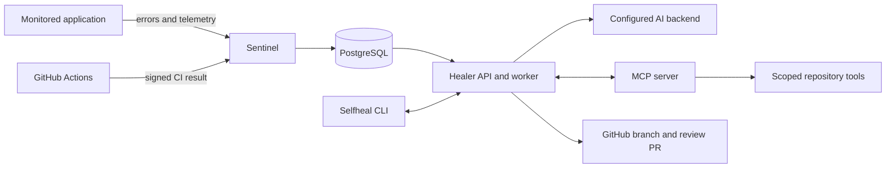

# Selfheal

- Capture runtime, contract, and CI failures.
- Gather scoped repository context through MCP tools.
- Propose candidate patches with a configured AI backend.
- Check patch policy and run tests in an isolated worktree.
- Open a GitHub pull request when verification succeeds.


[Repair-to-PR video](docs/demo-e2e-repairs.mp4) · [Terminal walkthrough](docs/demo-terminal.mp4)

Python 3.11+ · FastAPI · PostgreSQL · SQLAlchemy/Alembic · MCP · Typer · GitHub Actions

## Quick start

The CLI help runs without a database or provider credentials:

```powershell
python -m cli.main --help
```

For native PostgreSQL setup, local services, and credentials needed to run repairs, follow
[Local installation and operations](docs/operations.md). Keep local environment files out of Git.

## Tested on

| Repository | Classification | Verified scope and current outcome |
|---|---|---|
| [`selfheal-e2e-demo-01`](https://github.com/Deepak20466/selfheal-e2e-demo-01) | Synthetic, AI-generated repair | Controlled repair-to-PR trial; PR [#16](https://github.com/Deepak20466/selfheal-e2e-demo-01/pull/16) and CI passed; PR #16 is merged. |
| [`selfheal-e2e-demo-02`](https://github.com/Deepak20466/selfheal-e2e-demo-02) | Synthetic, AI-generated repair | Controlled repair-to-PR trial; PR [#13](https://github.com/Deepak20466/selfheal-e2e-demo-02/pull/13) and CI passed; PR #13 remains open. |
| [`selfheal-e2e-demo-03`](https://github.com/Deepak20466/selfheal-e2e-demo-03) | Synthetic, AI-generated repair | Controlled repair-to-PR trial; PR [#10](https://github.com/Deepak20466/selfheal-e2e-demo-03/pull/10) and CI passed; PR #10 remains open. |
| [`multi-agent-workspace`](https://github.com/Deepak20466/multi-agent-workspace) | Manual, engineer-directed and Claude-assisted | Dogfooding exposed two Selfheal defects, fixed in Selfheal commits [`ecba78b`](https://github.com/Deepak20466/selfheal-mcp-agent/commit/ecba78b90773d965d5218dce5688fb9cef6ef503) and [`c402003`](https://github.com/Deepak20466/selfheal-mcp-agent/commit/c402003ea41b7e2d8e5283a8954519e412c314d6). The PyPDF2 repair did not converge; a separate manual PR [#1](https://github.com/Deepak20466/multi-agent-workspace/pull/1) merged despite unrelated failing CI. |
| [ShopCart](https://github.com/Deepak20466/ShopCart) | Manual changes; AI-prepared onboarding | Selfheal onboarding PR [#1](https://github.com/Deepak20466/ShopCart/pull/1) needed manual setup repair before CI ran. The pagination bug was fixed manually (engineer-directed, Claude-assisted) in PR [#2](https://github.com/Deepak20466/ShopCart/pull/2); clean-build work was PR [#3](https://github.com/Deepak20466/ShopCart/pull/3); safe dependency updates were PR [#4](https://github.com/Deepak20466/ShopCart/pull/4). All four are merged. PR #4 reduced audit findings from 36 (5 critical, 17 high, 14 moderate) to 20 (3 critical, 7 high, 10 moderate). |
| [`vimj-studio-os-saas`](https://github.com/Deepak20466/vimj-studio-os-saas) | Manual GitHub search | No Selfheal run recorded in the reviewed PR, issue, and Actions listings. |
| [`attendance-academy-go-flutter`](https://github.com/Deepak20466/attendance-academy-go-flutter) | Manual GitHub search | No Selfheal run recorded in the reviewed PR, issue, and Actions listings. |
| [`attendance-academy-management-system`](https://github.com/Deepak20466/attendance-academy-management-system) | Manual GitHub search | No Selfheal run recorded in the reviewed PR, issue, and Actions listings. |

## Manually reported bugs

For logic bugs or untested repositories that no scanner category detects, record a human finding
with `selfheal report-bug --repo owner/repo --file src/app.py --description "Off-by-one on page 1"`,
then use `selfheal fix owner/repo <finding-id> --suggest`; this path always opens an UNVERIFIED,
human-review-only suggestion and cannot claim the normal verified route. See
[manual bug reporting](docs/manual-bug-reports.md).

## Real-world dogfooding

Engineer-directed, Claude-assisted dogfooding against `multi-agent-workspace` exposed two bugs in
Selfheal itself: dependency-audit findings were dropped when stderr corrupted JSON, and an
uncaught remote-verification exception could stop the worker. Both fixes have regression tests in
[`ecba78b`](https://github.com/Deepak20466/selfheal-mcp-agent/commit/ecba78b90773d965d5218dce5688fb9cef6ef503)
and [`c402003`](https://github.com/Deepak20466/selfheal-mcp-agent/commit/c402003ea41b7e2d8e5283a8954519e412c314d6).
They were not produced by Selfheal's repair loop. The PyPDF2 repair attempt did not converge; a
separate manual dependency PR [#1](https://github.com/Deepak20466/multi-agent-workspace/pull/1)
merged even though its required CI failed in an unrelated setup step.

ShopCart's onboarding PR [#1](https://github.com/Deepak20466/ShopCart/pull/1) was opened by
Selfheal's `selfheal prepare` flow but needed manual repair commit
[`b758bb1`](https://github.com/Deepak20466/ShopCart/commit/b758bb18dddefa67ec6bf9d69784135149fae035)
before CI could run: the workflow was nested, Vitest was unpinned and incompatible with the
project's Vite 4 line, and test imports used paths absent from the repository. The pagination bug
was found manually and fixed manually (engineer-directed, Claude-assisted) in ShopCart PR
[#2](https://github.com/Deepak20466/ShopCart/pull/2); this was not a Selfheal-generated repair.

The dated outcomes and evidence links are in [VERIFICATION.md](VERIFICATION.md) and the
[recovered evidence ledger](docs/history/RECOVERED_EVIDENCE.md).

## Real-bug benchmark status

Benchmark status: the predetermined 10-case pilot remains incomplete. Five attempt records across
v5, v7, and v8 cover two selected bugs; two v5/v7 requests timed out, and three v8 requests failed
with Gemini HTTP 400 because conversation history omitted thought signatures for function calls.
No repair completed; eight selected cases remain unattempted. v9 preserves the original cohort and
pilot IDs and fixes Gemini Part/function-response round-tripping. See the [real-bug benchmark
report](docs/benchmark-real-bugs.md) and [saved partial results](benchmarks/real_bugs/results/published/pilot-through-v8.md).
The historical fixture benchmark remains separate.

## Architecture



## Evidence and limitations

### Where it fails

The PyPDF2 repair did not converge, so no fix to that issue is claimed. ShopCart's pagination bug
was fixed manually (engineer-directed, Claude-assisted) in PR #2, not by Selfheal's repair loop.
Earlier seeded trials also include failed AI repair attempts and CI checks; the evidence ledger
links each result rather than counting only successful attempts.
The five saved attempt records have a 0/5 resolve rate and 0/5 full-suite-green resolve rate; no
repair completed. False-positive rate is not measurable (zero eligible human-fix denominator),
and cost is unknown for every attempt. Their overall median time is 121.094s. Failure categories
are `provider_error` (2) and `repair_error` (3). Eight selected bugs and the full 41-case run remain
unattempted. The scorer's failure categories are `no_patch`, `invalid_patch`,
`rejected_by_policy`, `tests_still_failing`, `timeout`, `provider_error`, `token_cap`, `cost_cap`,
`cost_unknown`, and `repair_error`; these are labels in the harness, not measured frequencies.
The v5/v7 timeouts occurred during Gemini `generateContent`, not MCP. The v8 HTTP 400 records show
Gemini rejected function-call history because the adapter dropped original signed Parts and sent
incorrect function-response names/IDs. v9 returns the original Parts and maps responses back to
their calls; offline regression coverage includes the `run_tests` rejection and multiple calls.
No live verification of this fix has been made. See the [partial results](benchmarks/real_bugs/results/published/pilot-through-v8.md)
and [Gemini adapter tests](tests/test_healer_api_adapters.py).

The no-policy ablation bypasses Selfheal's patch policy but still uses the OS sandbox for untrusted
repository tests. Pull requests are review artifacts; this evidence does not claim that tests alone
prove every change correct or establish merge-policy behavior. The records do not count a passing
test as a deployed change.

### Threats to validity

Historical synthetic trials used controlled defects and a small number of repositories; they do not
estimate performance on arbitrary repositories. The 20-case Codex fixture result used one synthetic
FastAPI repository, while the three later repair-to-PR demos used synthetic defects. The real-repo
evidence is a small set of engineer-selected tasks and does not establish sustained operation,
provider availability under prolonged rate limits, behavior on production traffic, or backup
recovery. Tests and API-backed demos do not establish kernel-level sandbox escape resistance.
Historical Claude Code costs are subscription-usage records, not API billing measurements. Provider
prices and quotas can change; the provider API could not attest the earlier free-tier account's full
billing state. The available evidence does not include an independent review of that billing
ledger. No Selfheal run was found for the VIMJ attendance system or either Attendance Academy
repository in the reviewed session logs, PRs, or Actions records.

For complete dated results and limitations, see [VERIFICATION.md](VERIFICATION.md),
[the evidence ledger](docs/history/RECOVERED_EVIDENCE.md), and the separate
[synthetic fixture benchmark](docs/benchmark.md). The retired browser UI screenshots and video are
kept under [legacy-web-ui-demo](docs/history/legacy-web-ui-demo/README.md); they do not show the
current terminal-first product.

## Documentation

- [Local installation and operations](docs/operations.md)
- [Architecture and security boundaries](docs/architecture.md)
- [Connect an application](docs/onboarding.md)
- [Runtime error demo](examples/runtime_demo/README.md)
- [Real-bug benchmark method](docs/benchmark-real-bugs.md)
- [Historical fixture benchmark](docs/benchmark.md)
- [Verification report](VERIFICATION.md)
- [Recovered evidence](docs/history/RECOVERED_EVIDENCE.md)
- [GitHub profile kit](docs/github-profile-kit.md)
- [Changelog](CHANGELOG.md)
- [MIT License](LICENSE)
