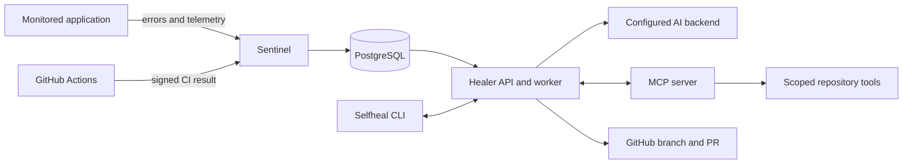

# Selfheal

AI-assisted repair for runtime and CI failures, with verified fixes and reviewable pull requests.

[](https://github.com/Deepak20466/selfheal-mcp-agent/actions/workflows/ci.yml)

## Demonstration

[](docs/demo-terminal.mp4)

The linked 0:50 recording is a genuine CLI walkthrough against the running app. It does not show the full AI repair-to-PR flow. A timed end-to-end recording plan, exact commands, and capture instructions are in [docs/demo-recording.md](docs/demo-recording.md); no full-flow footage has been recorded yet.

## What it does

Selfheal captures application errors and CI failures, gathers repository context through MCP tools, asks a configured AI backend for a repair, verifies the patch, and can open a pull request for human review.

- **Detect:** runtime exceptions, OpenTelemetry signals, scan findings, and failed GitHub workflows.
- **Diagnose and repair:** scoped AI agents inspect the failure and propose code plus regression tests.
- **Verify:** run the connected repository's checks in an isolated workspace before publishing a change.
- **Review:** create a branch and pull request; the service never merges AI-generated fixes.

## Technology

Python 3.11+, FastAPI, Typer/Rich, PostgreSQL, SQLAlchemy/Alembic, MCP, GitHub Actions and API, and pluggable provider adapters. Docker, Helm, and Kubernetes manifests are included; the Kubernetes path is exercised in CI. The local default runs as four native processes and needs no Docker installation.

## Architecture



The CLI, healer API, and MCP endpoint bind to loopback for local use. Only the sentinel webhook can be exposed, and only with the explicit `selfheal up --public` option. See [docs/architecture.md](docs/architecture.md) for data flow and trust boundaries.

## Verified results

| Evidence | Result |
|---|---|
| GitHub Actions CI on merged `main` | **Passed** at [`726b21e`](https://github.com/Deepak20466/selfheal-mcp-agent/commit/726b21ef1067db5a39a026b70b0d24c7d4cbf838); [post-merge run](https://github.com/Deepak20466/selfheal-mcp-agent/actions/runs/39222386393) |
| Calico-backed Kubernetes checks | **Passed** on merged `main`; [post-merge run](https://github.com/Deepak20466/selfheal-mcp-agent/actions/runs/39222386387) |
| Production deployment workflow | Completed with deployment steps skipped; [run](https://github.com/Deepak20466/selfheal-mcp-agent/actions/runs/39222386390) |
| Security follow-up PR #23 (open; review required) | **710 passed, 5 skipped, 3 warnings** in [CI](https://github.com/Deepak20466/selfheal-mcp-agent/actions/runs/39258574999); [Calico-backed kind](https://github.com/Deepak20466/selfheal-mcp-agent/actions/runs/39258574901) passed destination egress, MCP access, isolated app-database, migration, smoke, and recovery checks. No production deployment occurred. |
| Repository-authorization follow-up [PR #24](https://github.com/Deepak20466/selfheal-mcp-agent/pull/24), stacked on #23 | Local PostgreSQL suite: **720 passed, 8 skipped, 3 warnings**; hosted [CI](https://github.com/Deepak20466/selfheal-mcp-agent/actions/runs/39277153298) and [Calico-backed kind](https://github.com/Deepak20466/selfheal-mcp-agent/actions/runs/39277153207) passed. No deployment occurred. |
| Provider MCP capability [PR #25](https://github.com/Deepak20466/selfheal-mcp-agent/pull/25), stacked on #24 | Head [`7d3a4ff`](https://github.com/Deepak20466/selfheal-mcp-agent/commit/7d3a4ff179f0915cefc1012ff6d6bdd24fb41fec): hosted CI **737 passed, 5 skipped, 3 warnings** and Calico-backed Kubernetes checks passed. Workflow checkout credentials are not persisted; release-write permission and internal DNS names are restricted. Provider CLI execution remains fail-closed. [CI](https://github.com/Deepak20466/selfheal-mcp-agent/actions/runs/39291930768) · [Calico](https://github.com/Deepak20466/selfheal-mcp-agent/actions/runs/39291938720) |
| OpenRouter `:free` repair path ([implementation PR #26](https://github.com/Deepak20466/selfheal-mcp-agent/pull/26)) | Controller, artifact policy, bounded retry, separate Bubblewrap test job, and least-privilege PR job are implemented. Focused local tests pass; hosted isolation tests and live model-to-PR trials remain pending. The workflow is disabled by default. See [security boundary and setup](docs/openrouter-repair.md). |
| Repair benchmark | **20/20** diagnosis labels and repairs on the fixed scenario set; one scenario used a regression retry. See [method and limits](docs/benchmark.md). |
| Historical live repairs | [PR #10](https://github.com/Deepak20466/selfheal-mcp-agent/pull/10) and [PR #15](https://github.com/Deepak20466/selfheal-mcp-agent/pull/15) verified runtime fixes; [PR #14](https://github.com/Deepak20466/selfheal-mcp-agent/pull/14) demonstrated CI repair and a green rerun. These are historical runs, not a new live repair in the current audit. |

The benchmark measures a small, fixed fixture suite; it does not predict repair success on arbitrary repositories.

## Quick start

Requires Python 3.11+ and PostgreSQL 16. On Windows, run the [secure bootstrap steps](docs/operations.md#install-on-windows) to install dependencies, create local app/test databases, and apply migrations. Then:

```powershell
.\.venv\Scripts\python.exe scripts\hash_password.py
# Set ADMIN_PASSWORD_HASH and SESSION_SECRET in .env using the generated hash.
# Configure an authenticated AI_BACKEND in .env before requesting repairs.
.\.venv\Scripts\selfheal.exe up
.\.venv\Scripts\selfheal.exe login
.\.venv\Scripts\selfheal.exe status
```

Before starting, set an authenticated `AI_BACKEND` in `.env` if you plan to run repairs. Use a separate disposable test database; never point tests at production data. Keep `.env` out of Git and use a narrowly scoped GitHub token. Full setup, provider configuration, and CLI commands are in [docs/operations.md](docs/operations.md).

## Limits and safety

This is an engineering project, not a production certification for unattended repair of arbitrary repositories. Provider CLI execution currently fails closed because the provider and descendant processes lack verified OS containment. A future provider session receives a short-lived, job/worktree-scoped MCP token; that limits tool access but does not provide process or network isolation. Kubernetes policy enforcement, live hostile-repository and multi-repository reliability, and deployment recovery tests remain incomplete. Review [VERIFICATION.md](VERIFICATION.md), [docs/AUDIT_REPORT.md](docs/AUDIT_REPORT.md), and the [sandbox trust-boundary notes](docs/architecture.md#trust-boundaries) before connecting a repository.

## Documentation

- [Local installation and operations](docs/operations.md)
- [Architecture and security boundaries](docs/architecture.md)
- [Connect an application](docs/onboarding.md)
- [Demo recording guide](docs/demo-recording.md)
- [Benchmark method and results](docs/benchmark.md)
- [Verification report](VERIFICATION.md)
- [MIT License](LICENSE)
