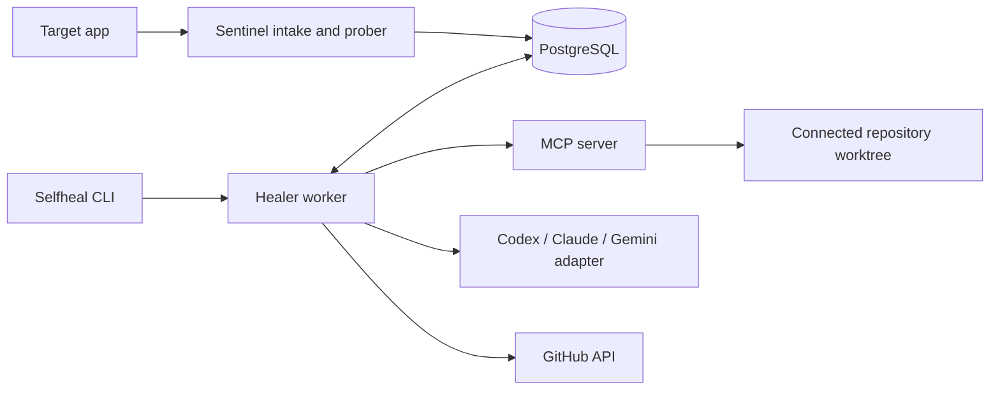

# Architecture and trust boundaries

## Services and repair flow

Selfheal runs four cooperating processes and PostgreSQL. The CLI and JSON API
are the user interface. Sentinel receives errors and contract-probe results.
The MCP server exposes repository and heal operations. The healer worker
claims jobs, asks a configured coding agent for a repair, runs verification,
and can prepare a GitHub change.

The normal repair path stores a finding and job in PostgreSQL, lets the worker
claim the job, obtains a proposed change, runs repository checks, and records
the result. GitHub push and pull-request operations are separate steps. This
audit used mocks and local repositories for those steps; it did not write to
GitHub.

## Trust boundaries

Repository files, test output, issue text, workflow logs, and model-produced
patches are untrusted data. The coding-agent prompt uses only the selected
scenario, application source, test source, and captured failure. The Codex
benchmark ran with read-only CLI sandboxing in a private temporary home. It
did not give the model the target repository directory or reference repair.

Direct MCP file reads, listings, blame, and code search also apply a common
credential-path denylist for `.env*` (except `.env.example`), provider and
cloud credential files, private-key extensions, and credential directories
such as `.aws/`, `.ssh/`, `.kube/`, `secrets/`, and `credentials/`. The repo
tree resource filters those paths as well. This is filename-based: it cannot
identify secrets embedded in ordinary source files or stored under arbitrary
names.

Repository-controlled commands run through
[`mcp_server/execution_sandbox.py`](../mcp_server/execution_sandbox.py).
It snapshots a repository into a disposable directory, omitting Git
metadata, symlinks/reparse points, and common credential files. It builds a
small environment without inherited provider, database, GitHub, webhook, or
cloud credentials. A failed sandbox setup returns an error; there is no
native-process fallback.

On Windows, commands run in an AppContainer with no declared network
capabilities. The sandbox grants access to its temporary workspace and the
specific runtime paths needed by the command. A Job Object limits process
count, memory, elapsed CPU time, and lifetime of child processes. The runner
also stops commands that exceed its wall-clock timeout, output cap, or
workspace-growth cap. Windows integration tests passed checks for blocked
outside reads/writes, loopback network, host environment credentials,
credential files, Git metadata, excessive children, and cleanup after timeout.
When the service runs from a Python virtual environment, the active venv prefix
and its `pyvenv.cfg` are granted read-only access so sandboxed child Python
processes can locate the base interpreter.
The scanner's fixed pytest/ruff/mypy/pip-audit tool set is bootstrapped into a
user-private cache outside connected repositories, then mounted read-only for
scan commands. Repository-provided executables cannot be used for host-side
scanner setup.

On Linux, commands require Bubblewrap, a non-root worker, isolated
namespaces, a writable workspace, read-only runtime mounts, and resource
limits. Missing Bubblewrap or root execution fails closed. The Windows host
does not have a WSL distribution, but the merged `main` CI run on Ubuntu
22.04 installed Bubblewrap, passed its namespace preflight, and passed the
PostgreSQL-backed test suite. That validates the automated integration path on
that hosted runner; it is not a review of kernel-level escape resistance.

The sandbox copies repository content, so filename-based credential
exclusions cannot recognize every secret stored under an arbitrary name or
embedded in ordinary source. The control plane must not store credentials in
connected repositories. Network access is intentionally unavailable to test
commands; dependency installation and online advisory checks are skipped.

## GitHub and provider credentials

Repository test environments are constructed with
[`core/process_env.py`](../core/process_env.py), which removes common
credential and service variables. MCP test execution also uses a separate
workspace snapshot and an OS-enforced no-network sandbox. Git authentication
for controlled operations is passed through a child-only Git configuration
environment, not the command line; failure output is scrubbed before logging.

In production, the GitHub client requires a GitHub App. It requests a
short-lived installation token for one exact repository and the minimum
permission needed for each REST operation (for example, `actions:read` for
workflow logs or `contents:write` for a branch push), then rejects responses
with a different repository or broader permissions. `GITHUB_ALLOWED_REPOSITORIES`
is an exact comma-separated allowlist; when unset, only `GITHUB_REPO` is
authorized. Mutation and token-mint events are logged without credentials.
The Helm chart omits the long-lived development token in production. Pushes
are restricted to `autofix/*` and
`selfheal-onboarding/*` by default, and protected branches are refused before
Git starts. AI-generated PRs always require human review and manual merging.

Provider CLI execution is **disabled**. The previous implementation launched
Codex, Claude Code, and Gemini on the host; provider-managed read-only settings,
tool allowlists, environment filtering, and timeout cleanup do not provide OS
containment. `require_provider_cli_sandbox()` fails closed before any provider
executable starts. Mock-based tests can bypass the gate only in their test
process. API-backed provider modes are separate and do not prove CLI process
isolation.

If a provider invocation is enabled after OS containment is verified, its MCP
connection receives a short-lived HMAC-signed capability instead of the
healer's bearer token. The capability expires within 15 minutes and limits
calls to diagnosis, source inspection, sandboxed tests, and patch proposals for
the caller's heal job and worktree. A CI repair may rerun only its recorded
workflow run once. Rollback, cancellation, other workflow mutations, and PR
creation are not provider capabilities. MCP checks these limits on every HTTP
request, including tool name, job, worktree, and run ID. These authorization
checks reduce the provider's MCP authority; they do not contain the provider
process or its network traffic, so the OS execution gate remains necessary.

The trusted healer and MCP workloads still hold GitHub App credentials for
control-plane work. Repository test subprocesses do not inherit those values
and are denied network access. The current deployment does not yet have a
separate provider worker that receives provider credentials without any
GitHub credentials; the CLI gate remains necessary until that worker exists.

## Kubernetes egress gateway

The Helm chart routes healer and MCP external HTTPS through the
`selfheal-egress` HTTP CONNECT gateway. Its exact hostname allowlist contains
the configured GitHub and provider API hosts. It rejects other hostnames,
non-443 CONNECT requests, TLS ClientHello SNI values that do not match the
CONNECT host, encrypted ClientHello, and DNS answers containing private or
special-use addresses; then it connects directly to a validated address.
NetworkPolicies limit app, sentinel, healer, MCP, migration, and PostgreSQL
egress to their required DNS and in-cluster destinations; only healer and MCP
may reach the gateway. PostgreSQL ingress permits the app, healer, MCP,
sentinel, and migration job. The app connection is further restricted by
PostgreSQL database privileges as described below. Production network-policy
enforcement depends on a CNI that applies these policies.

## Kubernetes database separation

The target app receives only the `target-app-database-url` value, for the
separate `selfheal_target_app` database and `selfheal_app` role. A trusted
migration Job receives both the control-plane and target-app URLs: it creates
the target role with `NOSUPERUSER`, `NOCREATEDB`, and `NOCREATEROLE`, creates
the target database, removes `PUBLIC` database privileges, grants the target
role access to its database, then migrates and seeds both databases. The
control-plane URL is not injected into the app pod.

The hosted kind check verifies the app's database name and role, confirms the
role's non-administrator flags, and confirms that it cannot connect to the
control-plane database. Both databases still run on the same PostgreSQL
server; this is logical database and role isolation, not a separate database
server or failure domain.

The chart runs a separate DNS-filter service. Workload pods use its reserved
ClusterIP as their only nameserver, and their NetworkPolicies allow DNS only to
that service. Among the chart workloads, only the filter can query CoreDNS.
The filter forwards A and AAAA queries only for exact configured
external hosts or names under `.svc.cluster.local`; it strips EDNS and other
additional records before forwarding, so a selected chart workload cannot
bypass the name check by querying CoreDNS directly. Set `dns.filterServiceIP` to an unused address in the cluster
Service CIDR and `dns.upstreamServiceIP` to the CoreDNS Service ClusterIP.

The hosted Calico-backed kind workflow tests an allowed GitHub request, TCP
reachability to the configured provider hosts, refusal of an unlisted external
name, denied direct DNS access to CoreDNS, denial of a non-allowlisted HTTPS
host, blocked direct egress around the gateway, and denied access from an
unselected pod to MCP, PostgreSQL, and the proxy. It also checks that the app
cannot connect to the control-plane database. These checks prove the
configured policy path in that ephemeral cluster only. The proxy permits
public IPv4 TCP 443 at the NetworkPolicy layer; the application gateway checks the exact
CONNECT hostname and requires matching TLS SNI. It does not inspect encrypted
HTTP paths, and an allowed service can still carry data through its normal API
protocol. Production enforcement depends on a CNI that applies Kubernetes
NetworkPolicy. The DNS filter and gateway are destination controls, not a
complete exfiltration-prevention boundary.

## Limits found in this audit

### Linux provider execution target

The existing Bubblewrap runner provides a non-root, no-network boundary for
repository-controlled test commands. It cannot host a provider CLI that needs
model and MCP connectivity. No verified network-aware provider worker is
available in the current environment, so Codex, Claude Code, and Gemini remain
fail-closed on every platform.

Enabling unattended CLI repair requires a disposable Linux worker on a cluster
with an enforced isolation runtime such as gVisor or Kata Containers, plus the
Calico-enforced egress policies and gateway. The worker must run as non-root,
without a service-account token, with a read-only root filesystem, a disposable
workspace mount, dropped capabilities, a restrictive seccomp profile, and
explicit CPU, memory, process, disk, and execution-time limits. It must receive
only the provider credential needed for its task; GitHub App credentials,
PostgreSQL, and host paths must remain inaccessible. The runtime and those
boundaries need adversarial integration tests on the actual Linux cluster
before changing the provider gate.

The Windows AppContainer tests cover the existing repository-command sandbox,
not provider execution. Ubuntu hosted CI verifies the Bubblewrap command
sandbox and the Calico NetworkPolicy path, but it does not test gVisor/Kata,
provider credentials, kernel escapes, live AI diagnosis, three independent
repository repairs, or production backup/restore and rollback. No production
resources or databases were changed.
