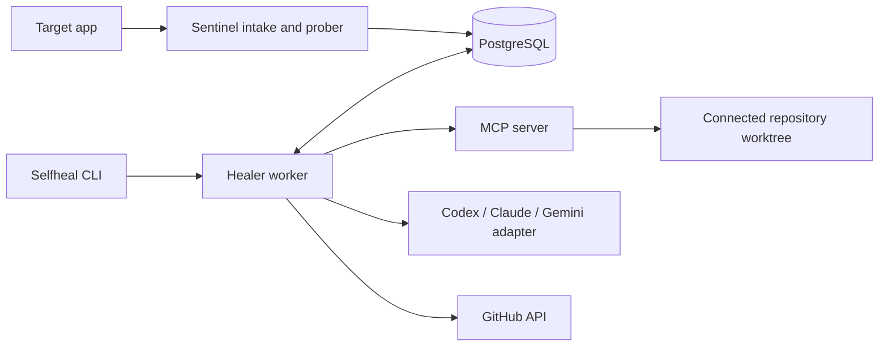

# Architecture and trust boundaries

## Services and repair flow

Selfheal runs four cooperating processes and PostgreSQL. The CLI and JSON API
are the user interface. Sentinel receives errors and contract-probe results.
The MCP server exposes repository and heal operations. The healer worker
claims jobs, asks a configured coding agent for a repair, runs verification,
and can prepare a GitHub change.

The normal repair path stores a finding and job in PostgreSQL, lets the worker
claim the job, obtains a proposed change, runs repository checks, and records
the result. GitHub push and pull-request operations are separate steps. This
audit used mocks and local repositories for those steps; it did not write to
GitHub.

## Trust boundaries

Repository files, test output, issue text, workflow logs, and model-produced
patches are untrusted data. The coding-agent prompt uses only the selected
scenario, application source, test source, and captured failure. The Codex
benchmark ran with read-only CLI sandboxing in a private temporary home. It
did not give the model the target repository directory or reference repair.

Direct MCP file reads, listings, blame, and code search also apply a common
credential-path denylist for `.env*` (except `.env.example`), provider and
cloud credential files, private-key extensions, and credential directories
such as `.aws/`, `.ssh/`, `.kube/`, `secrets/`, and `credentials/`. The repo
tree resource filters those paths as well. This is filename-based: it cannot
identify secrets embedded in ordinary source files or stored under arbitrary
names.

Repository-controlled commands run through
[`mcp_server/execution_sandbox.py`](../mcp_server/execution_sandbox.py).
It snapshots a repository into a disposable directory, omitting Git
metadata, symlinks/reparse points, and common credential files. It builds a
small environment without inherited provider, database, GitHub, webhook, or
cloud credentials. A failed sandbox setup returns an error; there is no
native-process fallback.

On Windows, commands run in an AppContainer with no declared network
capabilities. The sandbox grants access to its temporary workspace and the
specific runtime paths needed by the command. A Job Object limits process
count, memory, elapsed CPU time, and lifetime of child processes. The runner
also stops commands that exceed its wall-clock timeout, output cap, or
workspace-growth cap. Windows integration tests passed checks for blocked
outside reads/writes, loopback network, host environment credentials,
credential files, Git metadata, excessive children, and cleanup after timeout.
When the service runs from a Python virtual environment, the active venv prefix
and its `pyvenv.cfg` are granted read-only access so sandboxed child Python
processes can locate the base interpreter.
The scanner's fixed pytest/ruff/mypy/pip-audit tool set is bootstrapped into a
user-private cache outside connected repositories, then mounted read-only for
scan commands. Repository-provided executables cannot be used for host-side
scanner setup.

On Linux, commands require Bubblewrap, a non-root worker, isolated
namespaces, a writable workspace, read-only runtime mounts, and resource
limits. Missing Bubblewrap or root execution fails closed. The Windows host
does not have a WSL distribution, but the merged `main` CI run on Ubuntu
22.04 installed Bubblewrap, passed its namespace preflight, and passed the
PostgreSQL-backed test suite. That validates the automated integration path on
that hosted runner; it is not a review of kernel-level escape resistance.

The sandbox copies repository content, so filename-based credential
exclusions cannot recognize every secret stored under an arbitrary name or
embedded in ordinary source. The control plane must not store credentials in
connected repositories. Network access is intentionally unavailable to test
commands; dependency installation and online advisory checks are skipped.

## GitHub and provider credentials

Repository test environments are constructed with
[`core/process_env.py`](../core/process_env.py), which removes common
credential and service variables. Git authentication for controlled GitHub
operations is passed through a child-only Git configuration environment, not
the command line. Failure output is scrubbed before logging.

The provider CLI is the only subprocess that receives its provider login
material. The Codex benchmark copies the existing auth file into a
short-lived private home and removes that temporary home at completion.
Claude Code was installed but unauthenticated. Gemini CLI was not installed.
Neither was reported as a live success.

The provider CLI itself is not launched inside the project's AppContainer:
the model process needs its own network path, and this audit did not verify
its filesystem-read boundary or behavior under a live prompt injection. The
Windows AppContainer evidence in this document covers repository scan and
verification commands. Codex's configured read-only mode is a separate,
provider-managed control and is not a substitute for the project sandbox.

Provider CLI timeout handling now starts POSIX processes in their own session
and kills the process group, so child helpers do not outlive a timed-out turn.
The Windows path uses `taskkill /T`. These are lifecycle controls; they do
not place the provider CLI inside AppContainer or Bubblewrap, and the POSIX
descendant integration test passed on Ubuntu 22.04 in PR #19 CI. This is
hosted-runner integration evidence, not a kernel-escape assessment.

The native MCP HTTP listener defaults to loopback. The Docker image changes
the bind address to `0.0.0.0`, and the Helm chart exposes it as a ClusterIP
service without MCP bearer authentication or a NetworkPolicy. It is therefore
not internet-published by the chart, but any pod that can reach the service
can invoke MCP tools. Treat the cluster network as trusted until an
authenticated transport or verified network policy restricts that path.

The MCP server's Git metadata operations use direct, fixed argument lists and
filtered Git environments rather than shell commands. Blame/log, patch
application, search, and repository-tree listing have timeouts and terminate
their Git process on expiry. Git clone and push remain explicit control-plane
operations with child-scoped authentication; these network operations were
not exercised against GitHub in this audit.

## Limits found in this audit

- The Windows AppContainer path passed its integration boundary checks and
  ran the 20-scenario regression runner. Ubuntu 22.04 GitHub Actions passed
  Bubblewrap preflight and the full test suite on merged `main` and PR #19;
  the follow-up's process-group cleanup test passed on that hosted Linux run.
- The sandbox stages Node and npm inside its workspace and sets Node's
  preserve-symlinks options so the launcher does not need to traverse the
  protected root of C:. `npm test` passed the Node example's two in-process
  route/error-handler tests inside AppContainer. Those tests avoid loopback
  sockets because repository commands have no network capability. Node's
  `--test` worker mode timed out in this AppContainer, so the package script
  runs the same `node:test` file directly.
- The sandbox uses common filename and directory rules to omit credential
  files. It does not scan every file for secret-like content.
- A live prompt-injection exercise, a live self-healing repair PR, a staging
  deployment, and a live Kubernetes rollback were not run. PR #19 is the
  source-review PR for this hardening change, not a self-healing repair demo.

See [AUDIT_REPORT.md](AUDIT_REPORT.md) and [VERIFICATION.md](../VERIFICATION.md)
for the dated evidence and remaining readiness gates.
